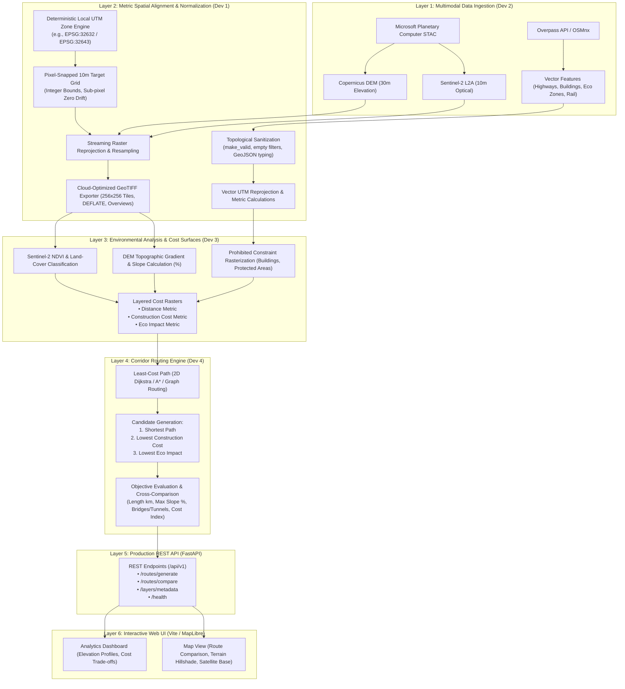

# GeoRoute AI — System Architecture Specification
**Document Version:** 1.0.0  
**Status:** PROPOSED (Pending Lead Engineer Review)  
**Author:** Software Architect / Lead Engineer  

---

## 1. Executive Summary & Architectural Scope

**GeoRoute AI** is an enterprise-grade automated geospatial infrastructure routing platform. The system ingests multimodal satellite imagery, digital elevation models (DEM), and OpenStreetMap vector data, standardizes them onto an integer-snapped metric Coordinate Reference System (CRS), computes environmental and topographic cost surfaces, and generates and evaluates three distinct infrastructure route candidates:
1. **Route 1: Minimum-Distance Route** (direct geometric alignment)
2. **Route 2: Minimum-Construction-Cost Route** (minimizes slope gradients, cut-and-fill earthwork, bridges, and tunnels)
3. **Route 3: Minimum-Environmental-Impact Route** (strictly avoids nature reserves, wetlands, and sensitive biomes)

The system is designed with a headless, modular Python core (`backend/georoute`), exposed via a production-grade **FastAPI** service (`backend/app`), and visualized through a modern, responsive web application (`frontend`).

---

## 2. High-Level System Architecture



---

## 3. Module Boundaries & Explicit File Ownership

To eliminate merge conflicts, concurrency race conditions, and architectural drift, file ownership is strictly partitioned across the four engineering roles:

| Module / Layer | Primary Owner | Directory / Files Owned | Key Technologies |
|---|---|---|---|
| **Geospatial Processing Foundation** | **Developer Agent 1** | `backend/georoute/utils/`<br>`backend/georoute/processing/`<br>`backend/tests/test_alignment.py`<br>`backend/tests/test_crs.py` | `pyproj`, `rasterio`, `shapely`, `affine`, `numpy` |
| **Geospatial Data Acquisition** | **Developer Agent 2** | `backend/georoute/ingestion/`<br>`backend/georoute/config.py`<br>`config/`<br>`backend/tests/test_config.py` | `pystac-client`, `planetary-computer`, `osmnx`, `tenacity` |
| **Vision, Analysis & Cost Surfaces** | **Developer Agent 3** | `backend/georoute/analysis/` *(New)*<br>`backend/tests/test_cost_surface.py` *(New)* | `numpy`, `rasterio`, `scipy.ndimage` |
| **Routing & Optimization** | **Developer Agent 4** | `backend/georoute/routing/`<br>`backend/tests/test_routing.py` *(New)* | `networkx`, `scipy.sparse`, `shapely` |
| **API Backend & System Integration** | **Lead Engineer / Integrator** | `backend/app/`<br>`main.py`<br>`backend/tests/test_api.py` *(New)* | `fastapi`, `uvicorn`, `pydantic` |
| **Frontend Map UI** | **Frontend Engineer** | `frontend/` | `vite`, `vanilla js` / `leaflet` / `maplibre-gl` |
| **Verification & Quality Audit** | **QA & Reviewer Agents** | `tests/e2e/`, audit reviews | `pytest`, `httpx` |

---

## 4. Interface Contracts & Data Schemas

### 4.1. Coordinate Reference System (CRS) & Grid Snapping Contract
1. **Storage & Serialization CRS**: All vector GeoJSON files and API JSON payloads MUST use **WGS84 (`EPSG:4326`)** with coordinates ordered as `[longitude, latitude]`.
2. **Computational Metric CRS**: All distance, area, slope, and cost computations MUST occur in the programmatically determined **local UTM zone** (`EPSG:326XX` or `EPSG:327XX`).
3. **Target Raster Grid Snapping**:
   - Resolution: Exactly `10.0m` (or configured metric resolution).
   - Bounds: Snapped to integer multiples of the resolution:
     $$\text{origin}_x = \lfloor \frac{\min(X)}{\Delta} \rfloor \cdot \Delta, \quad \text{origin}_y = \lceil \frac{\max(Y)}{\Delta} \rceil \cdot \Delta$$
   - Affine transform: `Affine(10.0, 0.0, utm_min_x, 0.0, -10.0, utm_max_y)`.
   - Nodata value: `-9999.0` for elevation and cost surfaces.

### 4.2. Cost Surface Layer Contract (`backend/georoute/analysis/cost_surface.py`)
Each cost layer is an aligned 2D float32 raster of identical dimensions:
* **Slope Cost ($C_{\text{slope}}$)**:
  * Calculated from resampled 10m DEM using Horn’s algorithm ($dz/dx, dz/dy$).
  * Slopes $< 2\% \rightarrow$ Cost multiplier 1.0 (ideal for rail).
  * Slopes $2\% - 4\% \rightarrow$ Cost multiplier 2.5 (moderate grading).
  * Slopes $4\% - 8\% \rightarrow$ Cost multiplier 6.0 (heavy cut-and-fill / tunneling required).
  * Slopes $> 8\% \rightarrow$ Prohibited (impassable for standard freight/passenger rail) or severe penalty ($10^6$).
* **Obstacle & Land-Use Cost ($C_{\text{land}}$)**:
  * Open ground / agricultural: Cost 1.0.
  * Forest / rugged terrain: Cost 2.0.
  * Water bodies: Bridge requirement penalty (Cost 5.0 to 10.0).
  * Building footprints: Strictly prohibited ($C = \infty$ or $10^9$).
  * Protected areas / Nature reserves:
    * For Construction Cost Route: Cost 2.0 (regulatory overhead).
    * For Environmental Impact Route: Strictly prohibited ($C = \infty$).

### 4.3. Route Candidate Output Schema (`GeoRouteResponse`)
```json
{
  "corridor": {
    "source": {"name": "Mandi, HP", "lat": 31.7084, "lon": 76.9322},
    "destination": {"name": "New Delhi RS", "lat": 28.6428, "lon": 77.2191}
  },
  "utm_epsg": 32643,
  "elapsed_seconds": 1.45,
  "candidates": [
    {
      "route_id": "route_1_shortest",
      "objective": "minimum_distance",
      "length_km": 373.26,
      "max_slope_percent": 6.8,
      "average_slope_percent": 1.2,
      "estimated_cost_index": 12840.0,
      "environmental_impact_score": 450.0,
      "geojson": {
        "type": "Feature",
        "geometry": { "type": "LineString", "coordinates": [[76.9322, 31.7084], "..."] },
        "properties": { "route_id": "route_1_shortest" }
      }
    },
    {
      "route_id": "route_2_lowest_cost",
      "objective": "minimum_construction_cost",
      "length_km": 375.33,
      "max_slope_percent": 3.1,
      "average_slope_percent": 0.8,
      "estimated_cost_index": 8420.0,
      "environmental_impact_score": 380.0,
      "geojson": { "type": "Feature", "geometry": { "type": "LineString", "coordinates": ["..."] } }
    },
    {
      "route_id": "route_3_eco_friendly",
      "objective": "minimum_environmental_impact",
      "length_km": 419.87,
      "max_slope_percent": 2.9,
      "average_slope_percent": 0.7,
      "estimated_cost_index": 10150.0,
      "environmental_impact_score": 42.0,
      "geojson": { "type": "Feature", "geometry": { "type": "LineString", "coordinates": ["..."] } }
    }
  ]
}
```

---

## 5. Security, Credential & Storage Rules

1. **Zero Secret Leaks**: No API keys, credentials, tokens, or SAS signatures may be hardcoded or checked into Git. All keys load via `.env` (which is in `.gitignore`).
2. **Safe File Operations**: Paths must be sanitized using `pathlib.Path.resolve()` to prevent path traversal attacks.
3. **No Heavy External Footprint**: SQLite/in-memory data structures are preferred for MVP state; PostGIS is reserved for enterprise multi-user persistence if explicitly required.
4. **Resilient HTTP Communication**: All external STAC and Overpass queries must use `tenacity` retry wrappers with bounded exponential backoff.
