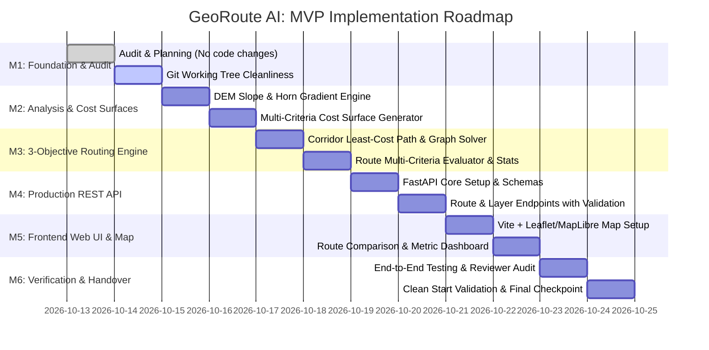

# GeoRoute AI — Production MVP Project Plan
**Document Version:** 1.0.0  
**Status:** PROPOSED (Pending Approval)  
**Lead Engineer:** AI Lead Engineer  

---

## 1. Project Goal & Definition of Done

Deliver a working, tested, production-grade **GeoRoute AI MVP** that:
1. Ingests and standardizes satellite (Sentinel-2), elevation (Copernicus DEM), and OpenStreetMap vector data on any bounding box.
2. Generates real terrain slope surfaces and multi-criteria cost models (topographic slope, land cover, and vector obstacles).
3. Produces and evaluates three genuine candidate routes (**Minimum Distance**, **Minimum Construction Cost**, and **Minimum Environmental Impact**).
4. Serves routes, layers, and metrics via a verified **FastAPI** backend with automated request validation.
5. Displays routes and spatial layers on an interactive, responsive **Web Map UI**.
6. Maintains 100% passing test coverage with automated unit, integration, and regression tests.

---

## 2. Milestone Breakdown & Delivery Roadmap

---

## 3. Milestones & Acceptance Criteria

### Milestone 1: Baseline Verification & Clean Git Checkpoint
* **Scope**:
  * Complete full repository audit.
  * Reconcile deleted root files with `backend/` files in Git staging.
  * Verify baseline test suite (26 passing tests).
* **Deliverables**: Clean `git status`, established test baseline.
* **Exit Gate**: All 26 unit tests pass on Python 3.12, no phantom deletions in Git status.

### Milestone 2: Environmental Analysis & Cost Surface Engine (`Developer Agent 3`)
* **Scope**:
  * Implement `backend/georoute/analysis/slope_calculator.py` using Horn's algorithm on 10m resampled DEM.
  * Implement `backend/georoute/analysis/cost_surface.py` to produce:
    1. Distance cost raster (uniform base cost).
    2. Construction cost raster (heavily penalized by slope $> 2\%$ and obstacles).
    3. Environmental impact raster (penalized/prohibited by protected zones and nature reserves).
* **Deliverables**: New analysis module + comprehensive unit tests (`test_cost_surface.py`).
* **Exit Gate**: Cost surfaces generated with verified matching shapes, CRS, and bounded numeric ranges.

### Milestone 3: Three-Objective Corridor Routing Optimization (`Developer Agent 4`)
* **Scope**:
  * Upgrade `backend/georoute/routing/railway_router.py` to integrate directly with generated cost surfaces and waypoint corridor graphs.
  * Implement multi-objective route candidate generation:
    1. **Shortest**: Minimum Euclidean/network distance.
    2. **Lowest Cost**: Minimizes slope gradient penalties and cut-and-fill zones.
    3. **Eco-Friendly**: Maximizes distance from protected zones and nature reserves.
  * Compute comparative metrics: Length (km), Max Slope (%), Mean Slope (%), Estimated Cost Index, Environmental Impact Score.
* **Deliverables**: Routing engine producing 3 genuine candidate alignments with metrics.
* **Exit Gate**: Algorithmic validation ensuring Route 2 has lower slope than Route 1, and Route 3 has lower eco-score than Route 1.

### Milestone 4: Production FastAPI Service (`Integrator / Lead`)
* **Scope**:
  * Complete `backend/app/main.py`, `backend/app/api/`, `backend/app/schemas/`.
  * Expose REST endpoints:
    * `GET /api/v1/health`: System health & dependency check.
    * `POST /api/v1/routes/generate`: Compute and return 3 candidate routes as GeoJSON FeatureCollection.
    * `GET /api/v1/layers/{region_id}`: Metadata and bounds for ingested rasters and vectors.
    * `GET /api/v1/routes/compare`: Side-by-side metric comparison table.
  * Integrate CORS middleware and OpenAPI Swagger documentation (`/docs`).
* **Deliverables**: Functional FastAPI server running via Uvicorn.
* **Exit Gate**: Automated HTTP tests (`backend/tests/test_api.py`) verifying all endpoints with valid status codes and response schemas.

### Milestone 5: Responsive Web Map UI (`Frontend Engineer`)
* **Scope**:
  * Initialize lightweight, modern frontend in `frontend/` using Vite + Vanilla JS / Leaflet / MapLibre.
  * Implement split-view or layered map showing:
    * Satellite / base map.
    * Topographic DEM layer / hillshade.
    * Three candidate routes color-coded by objective (Shortest: Blue, Lowest Cost: Amber, Eco: Green).
  * Metrics comparison card showing distance, slope %, and cost metrics.
* **Deliverables**: Working web application connecting to FastAPI backend.
* **Exit Gate**: Browser subagent verification showing map loading, route display, and interactive metric inspection.

### Milestone 6: End-to-End Verification, Code Review & Checkpoint
* **Scope**:
  * Independent reviewer audit of all changes.
  * Full regression test run across all modules.
  * Validation of clean setup instructions (`uv run ...` / `npm run dev`).
  * Final Git milestone commit.
* **Deliverables**: Final delivery report, verified documentation.
* **Exit Gate**: Zero failing tests, zero uncommitted stray files, clean startup verified.

---

## 4. Risk Management & Mitigations

| Risk | Impact | Probability | Mitigation Strategy |
|---|---|---|---|
| **Large GeoJSON files cause memory spikes** | High | Medium | Use streaming readers (`pyogrio`), return simplified LineStrings in API responses. |
| **External STAC / Overpass rate limits** | Medium | Medium | Maintain local caching (`ox.settings.use_cache = True`), exponential backoffs, pre-downloaded offline test datasets. |
| **Concurrent file editing across modules** | High | Low | Enforce explicit file ownership defined in `ARCHITECTURE.md`. |
| **Memory limits during 2D Least-Cost Path on massive corridors** | High | Medium | Use waypoint graph decomposition (`CORRIDOR_WAYPOINTS`) to bound Dijkstra search space to corridor bands. |
